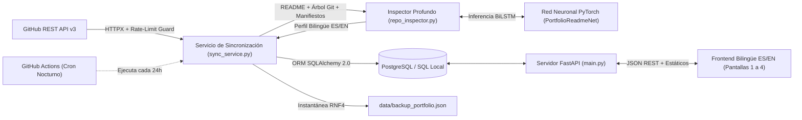
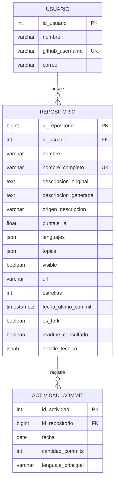

# Documentación Técnica — Portafolio Dinámico Auto-actualizable

## 1. Visión arquitectónica

El sistema implementa una arquitectura **Cliente-Servidor** desacoplada y resiliente:

- **Cliente Web (Frontend):** HTML5 semántico (`index.html`), hojas de estilo CSS3 responsivas (`src/css/styles.css`), módulos JavaScript ES6 (`src/js/app.js`, `src/js/utils.js`) y visualización estadística con Chart.js.
- **Servidor de Aplicación (Backend):** Python 3.11 + **FastAPI** + **Uvicorn** (`backend/main.py`), encargado de exponer la API REST, servir el cliente web y coordinar la sincronización con GitHub (`backend/github_service.py`, `backend/sync_service.py`).
- **Capa de Persistencia Relacional:** **SQLAlchemy 2.0** (`backend/database.py`, `backend/models.py`) compatible de forma nativa con **PostgreSQL** (`psycopg` v3, DDL en `database/schema.sql`) y con modo SQL local automático (`SQLite` con llaves foráneas activas) cuando `DATABASE_URL` no está definida, además de exportación continua a `data/backup_portfolio.json` (`RNF4`).
- **Motor Neuronal de PLN + Inspector Profundo de Código:** Red neuronal propia construida desde cero en **PyTorch** (`PortfolioReadmeNet` en `backend/ml/network.py`), complementada por el inspector profundo de repositorios (`backend/repo_inspector.py`), que examina árboles Git, manifiestos (`package.json`, `requirements.txt`, `composer.json`, `schema.prisma`), controladores, modelos ORM y puntos de entrada cuando un repositorio no dispone de un `README` descriptivo, generando perfiles técnicos bilingües (`ES` / `EN`) sin inventar datos.

---

## 2. Modelo de base de datos relacional

El esquema SQL (`database/schema.sql` y `backend/models.py`) materializa las tres entidades especificadas en el diseño del proyecto:

### Normalización de conexión a PostgreSQL
La función `normalize_database_url()` (`backend/config.py`) transforma automáticamente cualquier cadena estándar `postgres://...` o `postgresql://...` (como las entregadas por **Supabase** o **Neon**) al dialecto `postgresql+psycopg://...` requerido por SQLAlchemy 2.0 con `psycopg` v3, activando `pool_pre_ping=True` para tolerar reconexiones en la nube.

---

## 3. Modelo de lenguaje en PyTorch (`PortfolioReadmeNet`)

Para satisfacer `RF2` cumpliendo simultáneamente dos restricciones clave —**implementación completa en PyTorch** y **cero invención de datos falsos (Regla 6)**—, se diseñó un modelo neuronal extractivo-clasificador híbrido en `backend/ml/`.

### 3.1 Preprocesamiento y extracción de características (`backend/ml/tokenizer.py` e Inspector)
1. **Descarte documental de plantillas por defecto y activos estáticos:** Detecta `README`s autogenerados sin editar de *Create React App*, *Laravel*, *NestJS* o *Expo (`create-expo-app`)*, así como archivos auxiliares en carpetas de fuentes/estáticos (`public/fonts/README.md`) o menciones a `.woff/.woff2`, `localhost:` y `ENVIRONMENT:` para no atribuir texto irrelevante al proyecto del autor. Decodifica automáticamente archivos `UTF-8` y `UTF-16 BOM`.
2. **Limpieza estructural de Markdown:** Elimina bloques de código cercados, insignias (*badges* de `shields.io`), etiquetas HTML, encabezados `#`, subtítulos en negrita terminados en dos puntos, filas de tablas Markdown (`| col | col |`), comandos de consola (`npm`, `pip`, `git clone`) y marcas BOM (`\ufeff`).
3. **Vectorización dual por oración candidata:**
   - Tensor de índices de vocabulario `tokens` de longitud fija `max_seq_len = 36` (`<PAD> = 0`, `<UNK> = 1`, `vocab_size = 821`).
   - Vector numérico `feats` de **6 características estructurales** normalizadas en `[0, 1]`: posición relativa en el documento, longitud normalizada, densidad de términos técnicos/arquitectónicos, coincidencia léxica con el nombre/stack/topics del repositorio, indicador de ruido de instalación/licencia y proporción de dígitos/símbolos.

### 3.2 Arquitectura neuronal (`backend/ml/network.py`)
- **Capa de Embeddings:** `nn.Embedding(vocab_size, embed_dim=32, padding_idx=0)`.
- **Codificador secuencial:** `nn.LSTM` bidireccional (`hidden_size=32`, salida contextual de dimensión `64` por token).
- **Pooling de auto-atención enmascarada (`SelfAttentionPooling`):** proyecta cada paso temporal con `Linear(64, 32) -> Tanh -> Linear(32, 1)`, asigna `-1e9` a las posiciones `<PAD>` antes de `softmax` y calcula la suma ponderada del contexto semántico.
- **Rama estructural:** `Linear(6, 16) -> ReLU -> Dropout(0.35)`.
- **Fusión y cabezales duales:** concatena contexto textual y estructural (`64 + 16 = 80` dimensiones), aplica `Linear(80, 32) -> ReLU -> Dropout(0.35)` y alimenta dos cabezales lineales:
  - `salience_head`: probabilidad de que la oración describa el propósito o arquitectura real del proyecto.
  - `project_head`: clasificación auxiliar del tipo de sistema (aplicación interactiva vs herramienta/backend).

### 3.3 Entrenamiento y métricas (`backend/ml/train.py`)
- Corpus supervisado bilingüe en `backend/ml/dataset_readmes.json` con **80 ejemplos etiquetados** en español e inglés cubriendo descripciones reales (`.NET MAUI`, `ASP.NET Core`, `Three.js`/`WebXR`, `Laravel`, `YOLOv8`, `FastAPI`), comandos CLI, activos de fuentes, líneas `localhost`/`ENVIRONMENT`, licencias y plantillas por defecto.
- Función de pérdida combinada: $\mathcal{L} = \text{BCEWithLogits}(\text{salience}) + 0.5 \cdot \text{BCEWithLogits}(\text{project})$.
- Optimizador `AdamW` (`lr = 2e-3`, `weight_decay = 1e-2`) con planificador `CosineAnnealingLR`, `batch_size = 8`, `35` épocas y guardado automático del mejor *checkpoint* sobre partición estratificada (`80%` entrenamiento / `20%` validación):
  - `val_loss` mínimo: **0.4196** (época `15`).
  - Exactitud de relevancia en validación (`val_salience_acc`): **94.12%**.
  - Precisión (`val_salience_precision`): **100.0%**.
  - Sensibilidad / *Recall* (`val_salience_recall`): **87.50%**.
  - **F1-score (`val_salience_f1`)**: **0.9333**.
  - Exactitud auxiliar de tipo de proyecto (`val_project_acc`): **82.35%**.
- Artefactos persistidos en `backend/ml/artifacts/` (`readme_model.pt`, `vocab.json`, `training_metrics.json`).

---

## 4. Especificación de la API REST (`backend/main.py`)

| Método | Ruta | Descripción |
|---|---|---|
| `GET` | `/` | Sirve la interfaz principal `index.html`. |
| `GET` | `/data/backup_portfolio.json` | Sirve el archivo de respaldo local JSON (`RNF4`) para fallback sin servidor activo. |
| `GET` | `/api/health` | Estado operativo del servidor, motor SQL activo, total de repositorios en BD y métricas del modelo PyTorch. |
| `GET` | `/api/portfolio` | Devuelve configuración, metadatos, usuario, lista ordenada de repositorios, historial `actividad_commits` y tendencia semanal (incluyendo `desglose` por repositorio). Acepta `?user=NombreUsuario` para previsualizar en modo solo lectura otra cuenta pública sin alterar `config.json` ni `backup_portfolio.json` (`modo_vista_previa: true`). |
| `GET` | `/api/projects/{id}` | Devuelve el detalle completo de un repositorio específico por su clave primaria `id_repositorio`. |
| `GET` | `/api/config` | Devuelve el objeto actual de configuración (`config.json`), sus perfiles guardados (`perfiles_usuario`) y la bandera booleana `admin_key_requerida`. |
| `PUT` | `/api/config` | Valida cambios enviados desde la Pantalla 4 (`ConfigUpdatePayload`), soporta cambio dinámico de cuenta GitHub con perfiles aislados, persiste `config.json`, recalcula visibilidad en SQL al instante (`recalculate_db_visibility`) y devuelve el portafolio actualizado. Exige cabecera `X-Admin-Key` si se define `PORTFOLIO_ADMIN_KEY`. |
| `POST` | `/api/sync` | Ejecuta una sincronización paralela bajo demanda contra la API de GitHub (`?force=true` opcional), actualiza SQL y respaldo JSON, y retorna el estado actualizado (o `HTTP 429` controlado si se agotó el rate limit). |

---

## 5. Sincronización inteligente, paralelismo y automatización

1. **Ahorro de cuota por huella `pushed_at`:** `sync_service.py` compara `fecha_ultimo_commit` en SQL contra `pushed_at` reportado por GitHub; si un repositorio no tuvo commits nuevos y ya cuenta con perfil profundo, reutiliza sus lenguajes, descripción PyTorch e historial de commits sin repetir peticiones innecesarias (`RNF3`).
2. **Enriquecimiento paralelo y persistencia atómica SQL (`WAL`):** Las consultas HTTP a GitHub (`/languages`, `/readme`, `/git/trees`, manifiestos `.csproj`/`package.json`/`requirements.txt`, traducciones e historial de commits) se ejecutan en paralelo mediante `ThreadPoolExecutor(max_workers=8)` **antes** de abrir la transacción única de escritura en base de datos, protegiendo las operaciones concurrentes con `_sync_lock` y modo `PRAGMA journal_mode=WAL` en SQLite para evitar bloqueos y reducir la sincronización inicial de ~40 s a ~9 s.
3. **Aislamiento multiusuario por cuenta:** Los repositorios cacheados de múltiples cuentas públicas consultadas desde la Pantalla 4 o por `?user=` conviven en SQL sin sobrescribirse ni mezclarse (`get_active_user_and_repos()`), conservando los ajustes individuales por usuario en `perfiles_usuario`.
4. **Cobertura de ramas colaborativas y filtrado de bots:** `github_service.py` combina `/stats/commit_activity` (con reintento ante `HTTP 202`), `/commits?since=...` y `/repos/{owner}/{repo}/events` (`PushEvent`), descartando actores automatizados (`dependabot`, `[bot]`) para reflejar fielmente la actividad humana tanto en `main` como en ramas de equipo.
5. **Job programado en GitHub Actions (`.github/workflows/sync-portfolio.yml`):** se ejecuta todas las noches a las `08:00 UTC` (medianoche en Tijuana PST) y permite ejecución manual con `workflow_dispatch`, instala Python 3.11 + PyTorch CPU, sincroniza contra PostgreSQL / respaldo JSON y confirma cambios en `data/backup_portfolio.json`.

